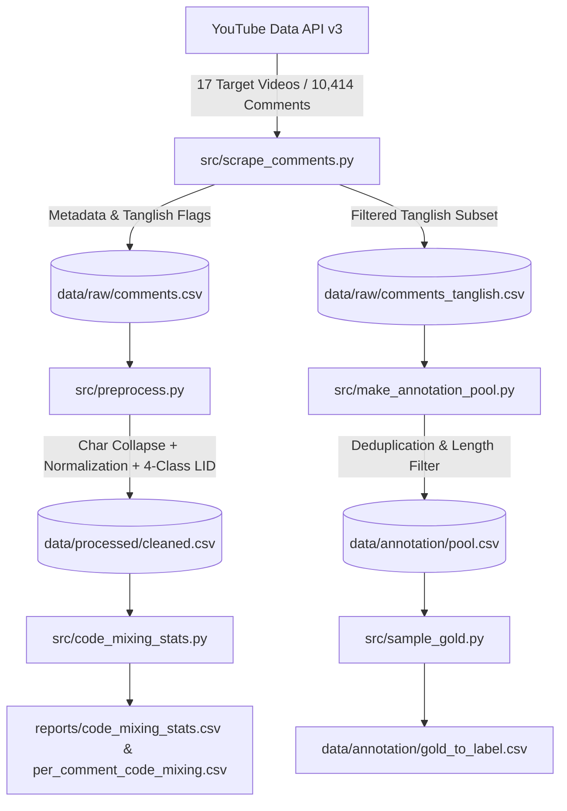

# Tanglish NLP Pipeline: Comprehensive Project Report

**Project Title**: Tanglish (Tamil-English) Social Media NLP Pipeline & Code-Mixing Analysis  
**Repository**: [Vikraman9869/NLP](https://github.com/Vikraman9869/NLP.git)  
**Date**: October 2026  
**Author / Maintainer**: Vikraman  

---

## 1. Executive Summary

This project delivers an end-to-end Natural Language Processing (NLP) pipeline specialized for collecting, preprocessing, analyzing, and structuring code-mixed **Tanglish** (Tamil written in Roman script mixed with English) and Tamil script comments from YouTube.

Code-mixed social media text in Indian languages presents severe challenges to conventional NLP architectures due to non-standard phonetic spellings, frequent code-switching, morphological suffixes attached to English root words, and extensive use of informal slang and emojis. This project establishes an empirical dataset, token-level Language Identification (LID), Code-Mixing Index (CMI) metrics, and a stratified annotation pool for downstream sentiment and sarcasm analysis.

---

## 2. Pipeline Architecture & System Overview



### Key Modules:
1. **Comment Scraper (`src/scrape_comments.py`)**:
   - Integrates YouTube Data API v3 (`commentThreads.list`, `order=relevance`).
   - Fetches video metadata (`videos.list`), tracks pagination, implements checkpointing/resuming via `reports/scrape_progress.json`, and records scrape errors to `reports/scrape_errors.log`.
2. **Preprocessor & Language Tagger (`src/preprocess.py`)**:
   - Cleans raw text, handles HTML entities, mentions, and URLs.
   - Collapses character elongations (e.g., `"semaaaaa"` $\rightarrow$ `"semaa"`).
   - Normalizes phonetic spelling variants.
   - Applies 4-class token-level Language Identification: `Tamil-Script`, `Tamil-Roman`, `English`, and `Other`.
3. **Token Inspectors (`src/inspect_tokens.py`, `src/inspect_english_tokens.py`)**:
   - Audits token tagging distributions and uncovers uncaptured Tanglish vocabulary.
4. **Code-Mixing Analyzer (`src/code_mixing_stats.py`)**:
   - Calculates the Code-Mixing Index (CMI) (Gambäck & Das, 2014) at both utterance and corpus levels.
5. **Annotation Sampling Pipeline (`src/make_annotation_pool.py`, `src/sample_gold.py`)**:
   - Generates a balanced, deduplicated pool and draws stratified samples for blind human annotation.

---

## 3. Data Collection & Scraping Statistics

- **Target Domains**: High-engagement Tamil movie trailers, teasers, promos, and vlogs.
- **Videos Scraped**: 17 videos (`data/video_list.csv`).
- **Total Comments Collected**: **10,414** raw comments (`data/raw/comments.csv`).
- **Filtered Tanglish Comments**: **2,747** comments with verified Tamil Roman / Script content (`data/raw/comments_tanglish.csv`).

### Video-Level Scrape Summary (`reports/scrape_stats.csv`):

| Video Title | Channel | Comments Fetched | Code-Mixed % |
|:---|:---|:---:|:---:|
| **Meesaya Murukku 2 - Official Trailer** | Saregama Tamil | 500 | **38.8%** |
| **Vetri Maaran’s Arasan - Promo** | Anirudh Ravichander | 500 | **35.0%** |
| **SEYON** | Raaj Kamal Films International | 500 | **34.6%** |
| **LEO - Official Trailer** | Sun TV | 500 | **27.0%** |
| **Jana Nayagan - Official Trailer** | KVN PRODUCTIONS | 500 | **26.4%** |
| **Retro Trailer** | T-Series Tamil | 500 | **26.2%** |
| **Kanguva - Tamil Trailer** | Saregama Tamil | 500 | **25.8%** |
| **Mandaadi - Trailer** | RS Infotainment | 500 | **25.8%** |
| **Glimpse of KH x RK Reunion** | Red Giant Movies | 500 | **22.6%** |
| **Baththa - Official Trailer** | Think Music India | 414 | **22.2%** |
| **Idhayam Murali - Trailer** | Think Music India | 500 | **21.8%** |
| **Hi :) - Movie Official Trailer** | Zee Studios South | 500 | **21.2%** |
| **KGF Chapter 2 Trailer (Tamil)** | Hombale Films | 500 | **19.8%** |
| **Toxic Official Tamil Trailer** | KVN PRODUCTIONS | 500 | **17.4%** |
| **PR Show - Launch Video** | PR Show | 500 | **15.2%** |
| **JAILER 2 - Official Trailer** | Sun TV | 500 | **11.0%** |
| **DC - Official Trailer** | Sun TV | 500 | **10.6%** |

---

## 4. Linguistic Distribution & Code-Mixing Analysis

The dataset was analyzed using the formulation by Gambäck & Das (2014):

$$\text{CMI} = 100 \times \left[ 1 - \frac{\max(w_{L1}, w_{L2}, \dots)}{L} \right] \quad (\text{for } L > 0)$$

where $L$ represents the total language-dependent tokens, and $\max(w_{Li})$ is the token count of the dominant language.
- Monolingual comment: $\text{CMI} = 0.0\%$
- Perfectly balanced bilingual comment: $\text{CMI} = 50.0\%$

### Dataset Linguistic Breakdown (`reports/code_mixing_stats.csv`):

| Metric | Count | Percentage | Description |
|:---|:---:|:---:|:---|
| **Total Comments Analyzed** | **2,000** | 100.0% | Representative processed subset |
| **Pure English Comments** | 1,318 | 65.90% | English-only tokens + optional emojis/punctuation |
| **Code-Mixed Comments (Tanglish)** | **342** | **17.10%** | Utterances containing both English and Tamil tokens |
| **Pure Tamil-Roman Comments** | 17 | 0.85% | Entirely Romanized Tamil tokens |
| **Pure Tamil-Script Comments** | 18 | 0.90% | Entirely native Tamil script tokens |
| **Non-Linguistic / Other** | 305 | 15.25% | Emojis, timestamps, numbers, and symbols only |
| **Mean CMI (Overall Dataset)** | **5.64%** | — | Average across all utterances |
| **Mean CMI (Code-Mixed Subset)** | **32.96%** | — | Significant mixing depth in the Tanglish subset |

### Token Frequency Distribution:
- **Total English Tokens**: 4,243 (32.77%)
- **Total Tamil-Roman Tokens**: 725 (5.60%)
- **Total Tamil-Script Tokens**: 158 (1.22%)
- **Total Non-Linguistic Tokens (Emojis/Symbols)**: 7,820 (60.40%)

---

## 5. Preprocessing & Language Identification (LID) Enhancements

The language identification engine employs a multi-tiered strategy:
1. **Script Detection**: Unicode range matching for native Tamil characters (`[\u0B80-\u0BFF]`).
2. **Lexicon Matching**: Comprehensive dictionary of common Tanglish words (e.g., *padam*, *thalaiva*, *semma*, *verithanam*, *vera maari*).
3. **Phonetic Normalization**: Maps phonetic variants (e.g., `da/daa`, `bro/nanba`, `thalaivar/thalaiva`).
4. **Morphological Suffix Engine**: Identifies Tamil inflections and markers suffixed to English/Tamil roots (e.g., `-oda`, `-ku`, `-la`, `-nga`, `-um`, `-pa`).
5. **Character Compression**: Eliminates character flooding (e.g., `superrrrrr` $\rightarrow$ `superr`).

---

## 6. Annotation Pool & Gold Sampling Strategy

To enable rigorous human annotation for sentiment and sarcasm:
- **Annotation Pool (`data/annotation/pool.csv`)**:
  - Filtered to **2,534** high-utility Tanglish comments.
  - Template and date-stamp suppression applied.
  - Minimum linguistic token threshold ($\ge 3$ tokens) enforced to remove single-word spam.
  - Near-duplicate deduplication completed.
- **Two-Stage Stratified Sampling (`src/sample_gold.py`)**:
  - Video-level stratification ensures coverage across all genres/channels.
  - LID-confidence stratification (high vs. low confidence) preserves natural difficulty distribution.
  - Blank annotation schema prepared: `comment_id`, `video_id`, `comment_text`, `sentiment`, `sarcasm`, `notes`.

---

## 7. Project File Structure

```text
NLP_Tanglish/
├── data/
│   ├── video_list.csv                  # 17 Scraped YouTube target videos & categories
│   ├── raw/
│   │   ├── comments.csv                # 10,414 Scraped YouTube comments with metadata
│   │   ├── comments_tanglish.csv       # 2,747 Filtered Tanglish comments
│   │   └── comments_backup_original.csv# Initial archive
│   ├── processed/
│   │   └── cleaned.csv                 # Cleaned & token-tagged dataset
│   └── annotation/
│       ├── pool.csv                    # 2,534 Deduplicated candidates for labeling
│       ├── lid_audit_100.csv           # 100-comment audit sample
│       └── lid_audit_low_30.csv        # Low-confidence audit subset
├── reports/
│   ├── project_report.md               # Complete Project Report
│   ├── scrape_stats.csv                # Per-video metrics & % code-mixed rates
│   ├── scrape_progress.json            # State tracker for scraping resumption
│   ├── code_mixing_stats.csv           # Corpus-level CMI and language distribution
│   └── per_comment_code_mixing.csv     # Granular utterance-level CMI metrics
├── src/
│   ├── scrape_comments.py              # YouTube API v3 scraper with Tanglish filter & resume
│   ├── preprocess.py                   # Normalization, repeated char collapse, 4-class LID
│   ├── inspect_tokens.py               # Token distribution inspection utility
│   ├── inspect_english_tokens.py       # English token auditor for vocabulary expansion
│   ├── code_mixing_stats.py            # Gambäck & Das CMI calculation module
│   ├── make_annotation_pool.py         # Filtering & deduplication for annotation pool
│   ├── sample_gold.py                  # Stratified gold sampling script
│   └── auto_label.py                   # Zero-shot classification pipeline (BART-MNLI)
├── .env.example                        # Environment variables template
├── .gitignore                          # Git exclusions (credentials & cache)
├── requirements.txt                    # Project dependencies
└── README.md                           # Documentation & pipeline execution guide
```

---

## 8. Current Status & Next Steps

- [x] High-throughput YouTube comments scraping pipeline built and executed across 17 videos.
- [x] Multi-tier 4-class token language identification implemented.
- [x] Code-Mixing Index (CMI) calculated and distribution tables generated.
- [x] Annotation pool constructed with audit samples.
- [x] Git repository synchronized and pushed to [GitHub](https://github.com/Vikraman9869/NLP.git).
- [ ] **Next Step**: Conduct blind human annotation on the gold dataset for sentiment and sarcasm.
- [ ] **Next Step**: Fine-tune domain-specific multilingual models (e.g., MuRIL, IndicBERT, XLM-RoBERTa) on labeled Tanglish benchmarks.
